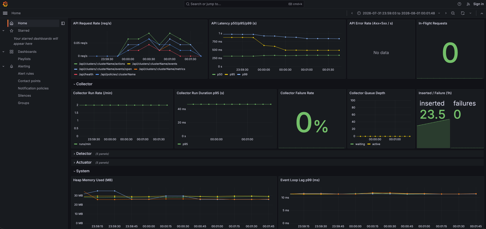
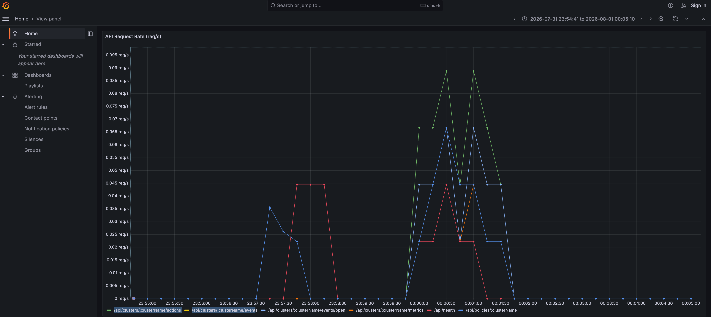
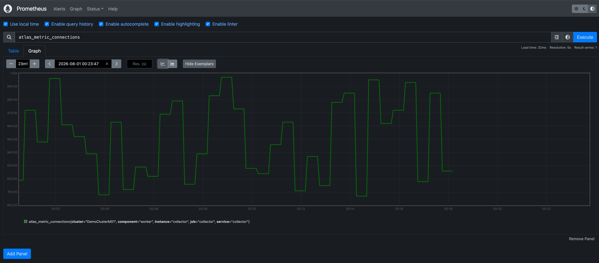
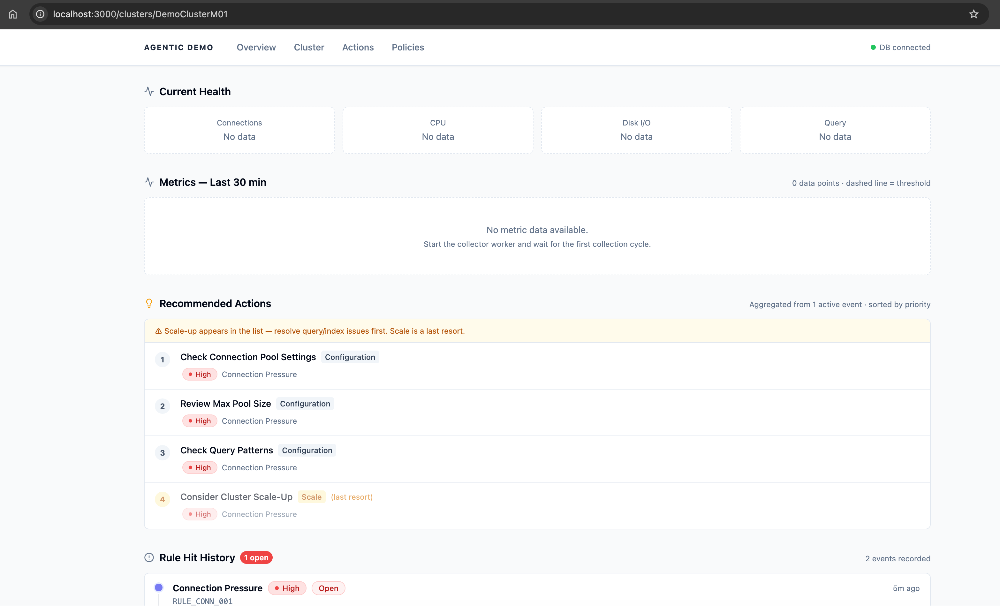

# Agentic Performance Demo

> **[한국어 문서 보기 →](./README_KR.md)**

An agentic operations assistant that collects MongoDB Atlas metrics, detects bottlenecks with a rule engine, and recommends or auto-applies scaling actions — all powered by MongoDB Atlas as the only infrastructure dependency.

This project is **not** a replacement for Atlas native autoscaling. It is a **higher-level control, explanation, and recommendation layer** that sits on top of it.

> **Status:** This project is suitable for **development and staging environments**. Before applying to production, review and address the following: API key secret management, job retry/backoff configuration, Atlas process cache invalidation on failover, and integration test coverage.

---

## Screenshots

### Grafana — Overview Dashboard


### Grafana — Metrics Detail


### Prometheus — Metrics Query


### Web UI — Bottleneck Event List


---

## Table of Contents

1. [Architecture](#architecture)
2. [Tech Stack](#tech-stack)
3. [Prerequisites](#prerequisites)
4. [Quick Start](#quick-start)
5. [Environment Variables](#environment-variables)
6. [Running the App](#running-the-app)
7. [Demo Scenarios](#demo-scenarios)
8. [API Reference](#api-reference)
9. [Observability](#observability)

---

## Architecture

```
                    ┌─────────────────────────────────┐
                    │     MongoDB Atlas Cluster        │
                    │  (metrics source + data store)   │
                    └──────────┬──────────────┬────────┘
                               │ Atlas API    │ MongoDB
                               │ (HTTPS/443)  │ (27017)
                    ┌──────────▼──────┐        │
                    │   [Collector]   │        │
                    │  every 30s      │        │
                    └──────────┬──────┘        │
                               │               │ atlas_metrics_ts
                    ┌──────────▼──────┐        │
                    │   [Detector]    │◄────────┘
                    │  every 60s      │
                    │  4 rule engine  │
                    └──────────┬──────┘
                               │ bottleneck_events
                    ┌──────────▼──────┐
                    │   [Actuator]    │
                    │  every 60s      │
                    │  + immediate    │
                    │  trigger        │
                    └──────────┬──────┘
                               │ policy_actions
                    ┌──────────▼──────┐    ┌─────────────┐
                    │   [API Server]  │◄───│  [Web UI]   │
                    │   Fastify/4000  │    │  Next.js    │
                    └─────────────────┘    └─────────────┘

         All workers scheduled via MongoDB (agendaJobs collection)
                         — No Redis required —
```

### Components

| Component | Path | Description |
|---|---|---|
| Web Dashboard | `apps/web` | Next.js 14 operator dashboard |
| API Server | `apps/api` | Fastify REST API |
| Collector | `workers/collector` | Atlas metrics collection worker |
| Detector | `workers/detector` | Rule-based bottleneck detection worker |
| Actuator | `workers/actuator` | Policy-based action generation worker |
| Shared | `packages/shared` | MongoDB client, types, repositories |
| Atlas | `packages/atlas` | Atlas Metrics API adapter (mock + real) |
| Rules | `packages/rules` | Rule engine (4 built-in rules) |
| Worker Utils | `packages/worker-utils` | Prometheus metrics + queue depth poller |

### Detection Rules

| Rule ID | Trigger Condition | Default Severity |
|---|---|---|
| `RULE_CONN_001` | `connections ≥ 800` | medium → high |
| `RULE_CPU_001` | `cpuNormalizedPct ≥ 70%` | medium |
| `RULE_DISK_001` | `diskQueueDepth ≥ 3` AND `memoryUsedPct ≥ 80%` | high |
| `RULE_QUERY_001` | `queryTargeting ≥ 100` | medium (index fix recommended, not scale) |

---

## Tech Stack

| Layer | Technology |
|---|---|
| Frontend | Next.js 14, React 18, Tailwind CSS, Recharts |
| Backend | Fastify, TypeScript, ESM |
| Job Scheduling | [Agenda](https://github.com/agenda/agenda) + MongoDB (`agendaJobs` collection) |
| Database | MongoDB Atlas (time-series + regular collections) |
| Metrics Adapter | Atlas Admin API v2 with HTTP Digest Auth |
| Observability | prom-client, Prometheus, Grafana |
| Monorepo | pnpm workspaces, Turborepo |

> **No Redis.** Job scheduling is handled by Agenda backed by the same MongoDB Atlas cluster.

---

## Prerequisites

| Tool | Min Version | Check |
|---|---|---|
| Node.js | 20 | `node --version` |
| pnpm | 9 | `pnpm --version` |
| Docker | 24+ | `docker --version` |
| MongoDB Atlas | M10+ cluster | Atlas console |

> **MongoDB M10+ is required** for the real Atlas Metrics API adapter.  
> M0/M2/M5 free-tier clusters do not expose the process-level metrics used by this app.  
> You can still run the demo with `COLLECTOR_ADAPTER=mock` on any cluster.

---

## Quick Start

```bash
# 1. Clone and install
git clone <repo-url>
cd agentic-performance-demo
pnpm install

# 2. Configure environment
cp .env.example .env
# Edit .env — set MONGODB_URI at minimum

# 3. Start monitoring infrastructure (Prometheus + Grafana)
docker compose -f infra/docker/docker-compose.infra.yml up -d

# 4. Start all services (5 terminals)
pnpm --filter @demo/api dev           # Terminal 1
pnpm --filter @demo/web dev           # Terminal 2
pnpm --filter @demo/worker-collector dev  # Terminal 3
pnpm --filter @demo/worker-detector dev   # Terminal 4
pnpm --filter @demo/worker-actuator dev   # Terminal 5

# 5. Open the dashboard
open http://localhost:3000
```

---

## Environment Variables

### Required

| Variable | Description |
|---|---|
| `MONGODB_URI` | MongoDB Atlas connection string (`mongodb+srv://...`) |

### MongoDB

| Variable | Default | Description |
|---|---|---|
| `MONGODB_DB_NAME` | `agentic_demo` | Database name (auto-created on first write) |
| `ATLAS_CLUSTER_NAME` | `perf-demo` | Cluster identifier used as label in events/actions |

### Atlas Metrics API (required only for `COLLECTOR_ADAPTER=mcp`)

| Variable | Description |
|---|---|
| `ATLAS_PROJECT_ID` | MongoDB Atlas Project ID |
| `ATLAS_PUBLIC_KEY` | Atlas API Key — public key |
| `ATLAS_PRIVATE_KEY` | Atlas API Key — private key |

Required Atlas API Key permission: **Project Read Only**

### Collector

| Variable | Default | Description |
|---|---|---|
| `COLLECTOR_ADAPTER` | `mock` | `mock` \| `mcp` |
| `COLLECTOR_MOCK_SCENARIO` | `normal` | `normal` \| `connection_surge` \| `cpu_saturation` \| `storage_pressure` \| `query_inefficiency` |
| `COLLECTOR_INTERVAL_SECONDS` | `30` | Collection interval (seconds) |
| `COLLECTOR_METRICS_PORT` | `4010` | Prometheus scrape port |

### Detector

| Variable | Default | Description |
|---|---|---|
| `RULE_WINDOW_MINUTES` | `5` | Sliding window for rule evaluation (minutes) |
| `DETECTOR_METRICS_PORT` | `4011` | Prometheus scrape port |

### Actuator

| Variable | Default | Description |
|---|---|---|
| `ACTUATOR_MODE` | `dry_run` | `dry_run` \| `approval_required` |
| `ACTUATOR_MAX_TIER` | `M60` | Maximum Atlas tier for scale-up recommendations |
| `ACTUATOR_COOLDOWN_MINUTES` | `30` | Cooldown between actions for the same cluster (minutes) |
| `ACTUATOR_METRICS_PORT` | `4012` | Prometheus scrape port |

### API Server

| Variable | Default | Description |
|---|---|---|
| `API_PORT` | `4000` | API listen port |
| `API_HOST` | `0.0.0.0` | API listen host |

### Web Dashboard

| Variable | Default | Description |
|---|---|---|
| `NEXT_PUBLIC_API_URL` | `http://localhost:4000` | API base URL (used by the browser) |

---

## Running the App

### Option A: Local Dev (recommended)

Run infrastructure in Docker, apps locally with hot-reload.

```bash
# Infrastructure
docker compose -f infra/docker/docker-compose.infra.yml up -d

# Each in a separate terminal
pnpm --filter @demo/api dev
pnpm --filter @demo/web dev
pnpm --filter @demo/worker-collector dev
pnpm --filter @demo/worker-detector dev
pnpm --filter @demo/worker-actuator dev
```

### Option B: Full Docker Stack

Build and run all services as containers.

```bash
docker compose -f infra/docker/docker-compose.yml up -d

# View logs
docker compose -f infra/docker/docker-compose.yml logs -f collector
```

### Service URLs

| Service | URL | Notes |
|---|---|---|
| **Web Dashboard** | http://localhost:3000 | Operator dashboard |
| **API Server** | http://localhost:4000 | REST API |
| API Health | http://localhost:4000/api/health | Health check |
| **Grafana** | http://localhost:3001 | Metrics dashboard (admin/admin) |
| **Prometheus** | http://localhost:9090 | Metrics query |
| Collector metrics | http://localhost:4010/metrics | Prometheus scrape |
| Detector metrics | http://localhost:4011/metrics | Prometheus scrape |
| Actuator metrics | http://localhost:4012/metrics | Prometheus scrape |

---

## Demo Scenarios

The fastest way to see the full pipeline in action is to use the mock adapter with a bottleneck scenario.

### Scenario 1: Healthy baseline

```env
COLLECTOR_ADAPTER=mock
COLLECTOR_MOCK_SCENARIO=normal
```

Expected: No events, no actions. All gauges green in Grafana.

### Scenario 2: Connection surge → scale-up recommendation

```env
COLLECTOR_ADAPTER=mock
COLLECTOR_MOCK_SCENARIO=connection_surge
```

**What happens (within ~2 minutes):**
1. Collector inserts `connections ≈ 950` every 30s
2. Detector triggers `RULE_CONN_001` → creates a `connection_pressure` event
3. Detector immediately pushes an `evaluate` job to the Actuator (no 60s wait)
4. Actuator creates a `scale_up_request` action

**Verify:**
```bash
curl http://localhost:4000/api/clusters/perf-demo/events?status=open
curl http://localhost:4000/api/clusters/perf-demo/actions
```

### Scenario 3: Query inefficiency → index fix (not scale)

```env
COLLECTOR_ADAPTER=mock
COLLECTOR_MOCK_SCENARIO=query_inefficiency
```

`queryTargeting ≈ 180` → `RULE_QUERY_001` → action type is `notify_only`.  
The actuator recommends reviewing indexes, **not** scaling up.

### Scenario 4: Approval-required workflow

```env
COLLECTOR_ADAPTER=mock
COLLECTOR_MOCK_SCENARIO=connection_surge
ACTUATOR_MODE=approval_required
```

Update the persisted policy via API:
```bash
curl -X PATCH http://localhost:4000/api/policies/perf-demo \
  -H "Content-Type: application/json" \
  -d '{"mode": "approval_required", "cooldownMinutes": 1}'
```

Actions appear in `http://localhost:3000/actions` with **Approve / Reject** buttons.

### Switching scenarios

Only the collector needs to be restarted when changing `COLLECTOR_MOCK_SCENARIO`.  
Detector and Actuator continue running.

---

## Using the Real Atlas Metrics Adapter

To collect metrics from an actual Atlas cluster instead of mock data:

### 1. Create an Atlas API Key

Atlas UI → **Project → Access Manager → API Keys** → Create  
Permission required: **Project Read Only**  
Add your IP to the API Key Access List.

### 2. Configure `.env`

```env
COLLECTOR_ADAPTER=mcp
ATLAS_PROJECT_ID=<your-project-id>
ATLAS_PUBLIC_KEY=<public-key>
ATLAS_PRIVATE_KEY=<private-key>
ATLAS_CLUSTER_NAME=<your-cluster-name>
```

### 3. Verify connectivity

```bash
curl --user "<public>:<private>" --digest \
  "https://cloud.mongodb.com/api/atlas/v2/groups/<project-id>/processes" \
  -H "Accept: application/vnd.atlas.2023-01-01+json" | python3 -m json.tool
```

### Metrics collected

| `NormalizedMetrics` field | Atlas Metric | Source |
|---|---|---|
| `connections` | `CONNECTIONS` | Process API |
| `cpuNormalizedPct` | `SYSTEM_NORMALIZED_CPU_USER` + `KERNEL` | Process API |
| `memoryUsedPct` | `SYSTEM_MEMORY_USED / (USED + AVAILABLE) × 100` | Process API |
| `diskUsedGb` | `DISK_PARTITION_SPACE_USED` ÷ 1 GiB | Disk Partition API |
| `diskQueueDepth` | `DISK_QUEUE_DEPTH` | Disk Partition API |
| `readLatencyMs` | `OP_EXECUTION_TIME_READS` | Process API |
| `writeLatencyMs` | `OP_EXECUTION_TIME_WRITES` | Process API |
| `queryTargeting` | `QUERY_TARGETING_SCANNED_OBJECTS_PER_RETURNED` | Process API |

> **Note:** The adapter fetches all metrics without explicit `m=` parameters (some Atlas metric names are not individually requestable via the v2 API) and extracts the required fields from the full response.

---

## API Reference

### Health

| Method | Path | Description |
|---|---|---|
| `GET` | `/api/health` | Server + DB connectivity status |

### Events

| Method | Path | Description |
|---|---|---|
| `GET` | `/api/clusters/:name/events` | List bottleneck events (filters: `status`, `severity`, `type`, `limit`, `since`) |
| `GET` | `/api/clusters/:name/events/open` | Open events only (fast path) |
| `POST` | `/api/clusters/:name/detect-now` | Trigger an immediate detection cycle |

### Actions

| Method | Path | Description |
|---|---|---|
| `GET` | `/api/clusters/:name/actions` | List actuator actions (filter: `result`, `limit`) |
| `GET` | `/api/actions/:id` | Get single action |
| `POST` | `/api/actions/:id/approve` | Approve a pending action |
| `POST` | `/api/actions/:id/reject` | Reject a pending action (body: `{ reason? }`) |

### Policies

| Method | Path | Description |
|---|---|---|
| `GET` | `/api/policies/:name` | Get cluster policy (auto-creates with defaults) |
| `PATCH` | `/api/policies/:name` | Update policy (`mode`, `maxTier`, `cooldownMinutes`, `allowActions`, `blockedActions`) |

---

## Observability

### Prometheus

Key metrics exposed:

| Metric | Worker | Description |
|---|---|---|
| `collector_run_total` | Collector | Total collection runs |
| `collector_run_failures_total` | Collector | Failed runs |
| `collector_run_duration_seconds` | Collector | Collection duration histogram |
| `atlas_metric_connections{cluster}` | Collector | Live connections gauge |
| `atlas_metric_cpu_normalized_pct` | Collector | CPU usage gauge |
| `detector_events_total{type,severity}` | Detector | Events created counter |
| `detector_open_events{cluster}` | Detector | Currently open events gauge |
| `actuator_actions_total{action_type,mode}` | Actuator | Actions created counter |
| `actuator_approvals_total{decision}` | Actuator | Approvals/rejections counter |
| `*_queue_depth{state}` | All workers | Agenda job queue depth (waiting/active) |

### Grafana

http://localhost:3001 (anonymous read access, no login required)

Dashboards are auto-provisioned from `infra/grafana/dashboards/`.

### MongoDB Collections

| Collection | Type | Contents |
|---|---|---|
| `atlas_metrics_ts` | Time-series | Raw metrics from collector (timeField: `timestamp`) |
| `bottleneck_events` | Regular | Detected events with severity and rule info |
| `policy_actions` | Regular | Actuator recommendations and approval state |
| `actuator_policies` | Regular | Per-cluster actuator configuration |
| `agendaJobs` | Regular | Agenda job scheduler state (replaces Redis/BullMQ) |

---

## Project Structure

```
agentic-performance-demo/
├── apps/
│   ├── api/              # Fastify REST API server
│   └── web/              # Next.js 14 dashboard
├── packages/
│   ├── atlas/            # Atlas Metrics adapter (mock + real MCP)
│   ├── rules/            # Rule engine (4 detection rules)
│   ├── shared/           # MongoDB client, types, repositories
│   └── worker-utils/     # Prometheus metrics server + queue depth poller
├── workers/
│   ├── collector/        # Metrics collection worker
│   ├── detector/         # Bottleneck detection worker
│   └── actuator/         # Policy action worker
├── infra/
│   ├── docker/           # Dockerfiles + docker-compose files
│   ├── prometheus/       # Prometheus config + alert rules
│   └── grafana/          # Grafana dashboards + provisioning
├── .env.example          # Environment variable template
├── pnpm-workspace.yaml
├── turbo.json
└── tsconfig.base.json
```

---

## License

MIT
